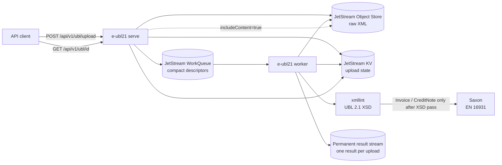

# e-ubl21

**e-ubl21** is a Go-based, asynchronous validation platform for **OASIS UBL 2.1** documents, with production-oriented support for **EN 16931** electronic-invoice validation and a roadmap toward **Peppol BIS Billing**, profile-aware validation, lossless XML/JSON document access, and multi-tenant e-invoicing services.

The project is designed around a simple principle: standards validation should be **deterministic, versioned, observable, durable, and independently testable**. A document must never be reported valid merely because a validator process failed, a later validation stage was skipped, or a standards asset silently changed.

The current server is already substantially beyond a simple XML validator. It provides an authenticated HTTP API, asynchronous validation through NATS JetStream, durable document and result state, UBL 2.1 validation for all 65 main document types, mandatory EN 16931 validation for Invoice and CreditNote, retry/dead-letter/replay handling, Prometheus metrics, structured logs, deterministic sample generation, and regression-contract infrastructure.

## Project direction

The long-term objective is a production-oriented UBL/e-invoicing platform capable of:

1. validating every UBL 2.1 main document type;
2. applying additional business-rule profiles such as EN 16931 and Peppol BIS Billing where applicable;
3. exposing the complete contents of UBL documents through an OpenAPI-described API;
4. supporting reversible XML ↔ JSON conversion without losing namespaces, attributes, ordering, extensions, or other UBL information;
5. storing and managing documents through a multi-tenant persistence layer;
6. evolving from a standards validator into a broader e-invoicing compliance gateway while keeping validation as a strict, independently verifiable core.

The high-level product roadmap is documented in [`.github/roadmap-0.md`](.github/roadmap-0.md). The prioritized implementation register is maintained in [`ISSUES.MD`](ISSUES.MD) and the detailed dependency order in [`IMPLEMENTATION-ORDER.md`](IMPLEMENTATION-ORDER.md).

## Current implementation status

### Implemented

- **All 65 UBL 2.1 main document types are recognized** from the authoritative UBL schema set.
- Every recognized UBL document is validated against its applicable **UBL 2.1 XSD**.
- UBL `Invoice` and `CreditNote` are additionally subject to mandatory **EN 16931** semantic validation.
- EN 16931 uses pinned validation assets and a controlled Saxon runtime rather than hand-written business rules.
- HTTP uploads are handled asynchronously: the API stores the original XML, records metadata, queues a compact work descriptor, and returns before validation finishes.
- **NATS JetStream** provides durable work queues, metadata KV storage, immutable raw-content Object Store storage, and a permanent one-result-per-upload result stream.
- Standards failures are kept distinct from **operational failures** such as validator crashes, timeouts, missing assets, or storage failures.
- Worker processing includes bounded concurrency, prefetch, deadlines, progress heartbeats, retry handling, dead-letter state, replay, duplicate suppression, and crash-safe result semantics.
- Raw XML retention is configurable and independent from long-lived validation metadata.
- The API exposes **OpenAPI 3.0.3**, Swagger UI, health checks, and Prometheus metrics.
- Protected routes use bearer JWT validation with the current HS256 issuer/audience/expiry security model.
- The project contains a deterministic **UBL 2.1 sample generator** and a tracked positive corpus covering all 65 main document types.
- Regression manifests use stable fixture IDs, SHA-256 hashes, standards versions, validation-stage expectations, and immutable generator provenance.

### Planned / in progress

The following are explicitly **not yet part of the current production validity contract**:

- Peppol BIS Billing validation;
- independently scalable XSD, EN 16931, and Peppol worker pools driven by a validation orchestrator;
- country-specific CIUS/profile validators;
- full generic JSON invoice creation and enrichment APIs;
- comprehensive lossless XML/JSON access for every UBL document type;
- multi-tenant PostgreSQL CRUD and search;
- Peppol network transport, SMP/SML discovery, AS4 access-point operation, or certificate handling.

See [`TODO-VALIDATION-SPLIT.md`](TODO-VALIDATION-SPLIT.md) and [`TODO-PEPPOL.md`](TODO-PEPPOL.md) for the next major architecture milestones.

Standards versions, authoritative sources, checksums, acquisition procedures,
and redistribution constraints are indexed under [`standard/`](standard/).

## Validation model

Validation is layered. A failure at an earlier standards layer prevents later standards layers from running.

For ordinary UBL documents:

```text
UBL XML
   |
   v
UBL 2.1 XSD
   |
   +-- invalid --> standards-invalid
   |
   v
valid for the UBL 2.1 profile
```

For `Invoice` and `CreditNote`:

```text
UBL XML
   |
   v
UBL 2.1 XSD
   |
   +-- invalid --> standards-invalid
   |
   v
EN 16931
   |
   +-- invalid --> standards-invalid
   |
   v
valid for the current UBL + EN 16931 profile
```

The planned Peppol profile adds a third standards stage:

```text
UBL 2.1 XSD -> EN 16931 -> Peppol BIS Billing
```

A validator/runtime failure is **not** a standards-invalid document. Operational failures remain retryable and are represented separately so infrastructure problems cannot silently become business-rule verdicts.

## Current runtime architecture

The transitional deployment uses separate API and combined-worker roles from
the same binary:

```text
e-ubl21 serve
e-ubl21 worker
```

The validation-split runtime exposes independent stage roles behind a durable
deployment-generation migration barrier:

```text
e-ubl21 orchestrator
e-ubl21 worker-xsd
e-ubl21 worker-en16931
e-ubl21 worker-peppol
```

The versioned Kubernetes base, independent resource and delivery settings,
KEDA JetStream autoscalers, and capacity formula are documented in
[`deploy/kubernetes/README.md`](deploy/kubernetes/README.md). The
`e-ubl21 provision` command is the deployer entry point for creating the
durable execution, stage, and deployment-generation topology before these
runtime roles start. The controlled stop/drain/reconcile/activate procedure is
documented in [`docs/DEPLOYMENT-MIGRATION.md`](docs/DEPLOYMENT-MIGRATION.md).

They communicate through NATS JetStream.



Raw XML is stored once. Work messages contain only compact descriptors referencing the upload, which keeps queue traffic small even for large documents.

The next architecture milestone splits the current combined validation worker into independent durable stages:

```text
API
 |
 v
Validation orchestrator
 |
 +--> XSD worker pool
 |
 +--> EN 16931 worker pool
 |
 +--> Peppol worker pool
```

Each stage will consume a durable `StageRequest`, publish a durable `StageResult`, and scale independently. The orchestrator alone will own the validation plan and final document status.

Distributed stage tracing uses OpenTelemetry and W3C Trace Context in durable
NATS headers. See [`docs/DISTRIBUTED-TRACING.md`](docs/DISTRIBUTED-TRACING.md)
for span names, safe attributes, queue/redelivery semantics, and OTLP export
configuration.

The shared version 1 wire models, deterministic per-attempt message IDs,
fail-closed decoding, outcome semantics, and evidence bounds are frozen in
[`docs/VALIDATION-STAGE-CONTRACTS.md`](docs/VALIDATION-STAGE-CONTRACTS.md).
The independently retained namespace-derived JetStream resources and their
deployer/runtime ownership boundary are defined in
[`docs/VALIDATION-STAGE-TOPOLOGY.md`](docs/VALIDATION-STAGE-TOPOLOGY.md).
The orchestrator-owned CAS state, immutable attempt evidence, plan transitions,
and terminal execution outcomes are defined in
[`docs/VALIDATION-ORCHESTRATOR.md`](docs/VALIDATION-ORCHESTRATOR.md).
The implemented independent UBL 2.1 XSD process, its durable ACK ordering and
its operational boundaries are documented in
[`docs/XSD-WORKER.md`](docs/XSD-WORKER.md).
The independently scalable EN 16931 process, prerequisite-evidence gate, and
pinned Saxon boundary are documented in
[`docs/EN16931-WORKER.md`](docs/EN16931-WORKER.md).

## HTTP API

The current public API is intentionally small and document-oriented.

| Method | Path | Purpose |
| --- | --- | --- |
| `GET` | `/` | Service metadata |
| `GET` | `/healthz` | API liveness |
| `GET` | `/metrics` | Prometheus metrics |
| `GET` | configured OpenAPI path, default `/openapi.json` | OpenAPI 3.0.3 document |
| `GET` | configured Swagger path, default `/swagger/` | Swagger UI |
| `POST` | `/api/v1/ubl/upload` | Store and queue a UBL 2.1 XML document |
| `GET` | `/api/v1/ubl/{id}` | Retrieve validation status and metadata |
| `GET` | `/api/v1/ubl/{id}?includeContent=true` | Retrieve status plus retained original XML |

Uploads are limited to 10 MiB. The API performs only lightweight root-element/document recognition synchronously. Full parsing, XSD validation, and applicable semantic validation happen asynchronously in the worker.

Select a validation contract with `validationProfile=auto`, `ubl21`,
`ubl21-en16931`, or `peppol-bis-billing`. Omitting the parameter is equivalent
to `auto`. Upload and status responses expose `requestedProfile` and the
immutable concrete `resolvedProfile`; the older `profile` query/response field
remains a deprecated compatibility alias. Explicit Peppol requests never
downgrade to EN-only validation when identifiers are unsupported.

See [`server/openapi.yaml`](server/openapi.yaml) for the machine-readable API contract and [`server/FUNCTIONALITY.md`](server/FUNCTIONALITY.md) for the detailed current server behavior.

## Queue and durable storage model

All JetStream names can be scoped by `--queue-namespace` / `EUBL21_QUEUE_NAMESPACE`, allowing several e-ubl21 deployments to share one NATS cluster without colliding.

With the default namespace, the principal resources are:

| Resource | Default name | Purpose |
| --- | --- | --- |
| Work stream | `UBL_DOCUMENTS` | Durable validation work queue |
| Upload metadata KV | `UBL_UPLOADS` | Mutable upload and validation state |
| Raw-content Object Store | `UBL_UPLOAD_CONTENT` | Immutable original XML |
| Result stream | `UBL_VALIDATION_RESULTS_BY_UPLOAD` | Permanent per-upload validation outcome / uniqueness record |

The result stream deliberately retains one immutable result subject per upload. This is part of the replay/idempotency design, not merely an event log.

## EN 16931 runtime

For `Invoice` and `CreditNote`, the worker runs the pinned EN 16931 semantic-validation stage after UBL XSD succeeds.

The current packaged runtime includes:

- EN 16931 UBL validation artefact **1.3.16**;
- **Saxon-HE 12.7**;
- **XML Resolver 6.0.17**;
- a restricted Saxon configuration;
- checksum verification of packaged assets;
- bounded stderr, SVRL, issue counts, and diagnostic fields;
- startup smoke verification;
- no runtime network download of standards rules.

Deployment, runtime pinning, upgrade rules, and offline verification are documented in:

- [`docs/EN16931-VALIDATION-CONTRACT.md`](docs/EN16931-VALIDATION-CONTRACT.md)
- [`docs/EN16931-DEPLOYMENT.md`](docs/EN16931-DEPLOYMENT.md)
- [`docs/EN16931-ASSET-UPGRADE.md`](docs/EN16931-ASSET-UPGRADE.md)
- [`docs/EN16931-COMPLIANCE-GATE.md`](docs/EN16931-COMPLIANCE-GATE.md)
- [`docs/EN16931-CAPACITY.md`](docs/EN16931-CAPACITY.md)
- [`docs/PEPPOL-ASSET-UPGRADE.md`](docs/PEPPOL-ASSET-UPGRADE.md)

## Sample generation and regression corpus

`createsamples/` is a separate standards-test-data workstream rather than server runtime code.

The structural UBL generator is schema-driven and currently produces a deterministic positive fixture for **every one of the 65 UBL 2.1 main document schemas**. Generation:

- uses the authoritative XSD graph;
- generates the complete corpus twice and rejects byte differences;
- creates a canonical manifest automatically;
- computes SHA-256 for every fixture;
- records immutable generator/XSD provenance;
- rejects dirty relevant inputs during automatic provenance resolution;
- validates every generated XML document independently with `xmllint`;
- verifies that a fresh generation is byte-identical to the tracked corpus;
- protects generated-output replacement with a generator ownership marker and staged directory replacement.

Generate the current UBL positive corpus with:

```bash
go run ./createsamples generate \
  --profile ubl21 \
  --set positive \
  --xsd XSD \
  --output createsamples/samples
```

Generate the independent EN 16931 corpus (seven positive Invoice VAT-family
variants, one positive CreditNote, two pinned official examples, and 22
targeted-negative Invoices) with:

```bash
go run ./createsamples generate \
  --profile en16931 \
  --set all \
  --xsd XSD \
  --output createsamples/samples-en16931
```

The regression contract lives under [`regression/`](regression/) and defines stable fixture-manifest and normalized-result schemas. The current tracked corpora cover UBL positives and targeted negatives, EN 16931 positives and rule-targeted negatives, and Peppol candidate positives.

Generate the deterministic Peppol BIS Billing positive corpus with:

```bash
go run ./createsamples generate \
  --profile peppol-bis-billing \
  --set positive \
  --xsd XSD \
  --output createsamples/samples-peppol
```

The corpus combines generated Profile 01/02 Invoice and CreditNote fixtures
with all ten byte-for-byte official examples from the pinned OpenPeppol source
commit. It covers representative VAT categories, payment means, identifier
schemes, allowances/charges, attachments/references, and country-specific
rules. Every manifest entry requires ordered XSD, EN 16931, and Peppol passes.

Run the mandatory positive-conformity gate with:

```bash
make test-peppol-positive
```

The gate verifies the pinned runtime dependencies and executes every positive
fixture through real `xmllint` and Saxon transforms. Missing dependencies fail
the gate rather than skipping it.

Generate the rule-targeted negative Peppol corpus with `--set negative`, or
include it beside the positive fixtures with `--set all`. The negative set has
13 XSD-valid and EN-valid Peppol mutations spanning identifiers, endpoints,
party schemes, code lists, payment, cardinality, currency, arithmetic,
`PEPPOL-COMMON-*`, and country rules. Each records the exact official rule IDs
expected from the pinned runtime. Three additional controls stop at XSD or EN.
The EN controls document that missing `CustomizationID` is rejected by `BR-01`
and unsupported attachment MIME is rejected by `BR-CL-24`, rather than
misrepresenting either as Peppol-only. Both EN controls are excluded from
Peppol-targeted family coverage.

Run the mandatory negative-conformity gate with:

```bash
make test-peppol-negative
```

The gate treats runtime dependencies as mandatory, validates each fixture only
through its declared ordered stages, and verifies exact rule evidence at the
first failing stage.

Cross-check all official examples and a reviewed invalid rule/severity sample
against both the accepted server stylesheet and a fresh compilation of the
exact pinned official source with:

```bash
make test-peppol-reference
```

The frozen inventory, normalization boundary, and evidence model are described
in [`docs/PEPPOL-REFERENCE-CROSS-CHECK.md`](docs/PEPPOL-REFERENCE-CROSS-CHECK.md).

Run the final public-contract gate with:

```bash
make test-peppol-compliance
```

This first verifies the accepted normalized Peppol release baseline, then sends
the complete corpus through the authenticated HTTP API, Object Store, separate
XSD/EN/Peppol workers, durable orchestrator, and permanent result stream. It
also proves stage short-circuiting, Profiles 01/02, EN-only compatibility,
retry/DLQ replay, crash/restart recovery, and duplicate-message convergence.

Run a tracked manifest through the authenticated public API and durable result
path with `go run . regression`; see [`regression/README.md`](regression/README.md)
for token, profile, polling, and artifact options. Each run emits deterministic
`results.jsonl`, `summary.json`, and `junit.xml` evidence, plus a volatile
`run-map.jsonl` for fixture-to-upload correlation, and exits non-zero on any
semantic mismatch.

After a run—successful or failed—`go run . regression collect-evidence`
collects bounded, redacted service logs, metrics, selected NATS state,
environment metadata, and optional Kubernetes events/pod logs beside those
normalized files. See [`regression/README.md`](regression/README.md) for the
artifact layout and source flags.

Run the same semantic regression path through the real local Kubernetes
topology with `make regression-minikube`. It builds and loads the candidate
image into a dedicated Minikube profile, deploys namespace-isolated NATS plus
the API and worker, waits for readiness, retains normalized results and
diagnostics below `regression-results/minikube/`, and removes the disposable
namespace. See [`deploy/minikube/README.md`](deploy/minikube/README.md) for
prerequisites and overrides.

The non-Kubernetes correctness gate is available locally as
`make regression-correctness` and runs automatically for pull requests and
pushes to `main`. It regenerates and byte-compares both tracked corpora, runs
the authenticated API/worker topology with the pinned validation runtime,
executes both manifests, and retains normalized results, JUnit, logs, metrics,
and evidence on success or failure. GitHub's job summary lists any failed
fixture IDs directly.

The durable split-stage failure gate is available as
`make test-validation-chaos`. It injects the 15 required orchestrator/worker
crash, lost-ACK, duplicate-delivery, transient-storage, restart-backlog,
scale-to-zero, stale-generation, and concurrent-replay scenarios against
JetStream. The scenario matrix and exact convergence assertions are documented
in [`docs/CHAOS-CRASH-REPLAY.md`](docs/CHAOS-CRASH-REPLAY.md). This gate runs
before the semantic correctness regression in GitHub and fails immediately if
any test mapped to a required scenario has been renamed or removed.

GitHub also runs the local `make regression-minikube` lifecycle against both
tracked corpora in parallel disposable clusters. This hosted Kubernetes gate
uses the same candidate-image build/load, deployment, authenticated semantic
runner, evidence collection, and cleanup code as local Minikube; it does not
maintain a second CI-specific regression implementation.

Both regression tiers additionally compare their normalized semantic output
with the reviewed pre-split monolithic baselines in
`regression/baselines/validation-split/`. This gate requires exact fixture
outcomes, ordered validation stages, and actual rule-ID sets, so the future
distributed validation refactor cannot silently change standards behavior.

See [`TODO-REGRESSION-CORPUS.md`](TODO-REGRESSION-CORPUS.md) and [`regression/README.md`](regression/README.md).

## Running the project

### Requirements

For normal Go development:

- **Go 1.25** (as declared by `go.mod`);
- a reachable **NATS server with JetStream** for API/worker operation;
- `xmllint` / libxml2 for UBL XSD validation and corpus validation.

For the mandatory EN 16931 runtime/tests, Java/Saxon/XML Resolver and the pinned validation assets are also required. The production Docker image packages the controlled runtime.

For relational database development, start the pinned authenticated
YugabyteDB/YSQL runtime and run its application integration test with:

```bash
make database-test
```

Use `make database-stop` to retain its persistent volume or the destructive
`make database-reset` to remove it. The full lifecycle and acceptance check are
documented in [`docs/LOCAL-YUGABYTEDB.md`](docs/LOCAL-YUGABYTEDB.md).

### Docker Compose

The easiest complete local topology is:

```bash
docker compose up --build
```

The compose topology provides:

- NATS / JetStream on `4222`;
- NATS monitoring on `8222`;
- e-ubl21 API on `8080`;
- worker metrics/health on `9091`.

The API and worker use the same Docker image but different commands. Worker replicas can be scaled independently.

```bash
docker compose up --build --scale worker=3
```

The compose file contains development defaults only. In particular, replace the default HMAC secret and configure issuer/audience appropriately before treating the deployment as secure.

### Run the API directly

```bash
go run . serve \
  --host 127.0.0.1 \
  --port 8080 \
  --nats-url nats://localhost:4222 \
  --oauth-hmac-secret '<development-secret>'
```

### Run a worker directly

```bash
go run . worker \
  --nats-url nats://localhost:4222
```

The worker requires its validation runtime configuration to be valid before it begins consuming work. See the EN 16931 deployment guide for controlled local paths and production defaults.

### Run the independent XSD stage worker

After the validation-stage topology has been provisioned, run only the UBL 2.1
XSD consumer with:

```bash
go run . worker-xsd \
  --nats-url nats://localhost:4222
```

It publishes durable XSD `StageResult` messages and can continue while the EN
worker is stopped. See [`docs/XSD-WORKER.md`](docs/XSD-WORKER.md) for its
ownership, retry, shutdown, and rollout contract.

### Run the independent EN 16931 stage worker

After the validation-stage and execution/evidence infrastructure has been
provisioned, run only the EN 16931 consumer with:

```bash
go run . worker-en16931 \
  --nats-url nats://localhost:4222
```

The command verifies passing XSD evidence before invoking the pinned Saxon
runtime. EN work remains durable while this role is scaled to zero. See
[`docs/EN16931-WORKER.md`](docs/EN16931-WORKER.md).

### Run the independent Peppol stage worker

After provisioning, run the third-stage Peppol Billing consumer with:

```bash
go run . worker-peppol \
  --nats-url nats://localhost:4222
```

It consumes only orchestrator-authorized Peppol requests after durable XSD and
EN pass evidence. Public selection of the Peppol profile remains owned by
issue #75. See [`docs/PEPPOL-WORKER.md`](docs/PEPPOL-WORKER.md).

### Provision and run the validation orchestrator

The split runtime requires deployer-owned durable infrastructure. Provision it
with stage-specific acknowledgement windows and fleet-wide pending limits:

```bash
go run . provision \
  --nats-url nats://localhost:4222 \
  --stage-xsd-ack-wait 90s \
  --stage-xsd-max-ack-pending 64 \
  --stage-en16931-ack-wait 120s \
  --stage-en16931-max-ack-pending 32
```

Then run the independent result consumer and reconciliation loops:

```bash
go run . orchestrator \
  --nats-url nats://localhost:4222 \
  --orchestrator-role combined \
  --orchestrator-result-prefetch 8 \
  --orchestrator-reconcile-interval 10s
```

Kubernetes runs `--orchestrator-role consumer` in the autoscaled result-reader
Deployment and `--orchestrator-role reconciler` in one fixed repair Deployment,
so adding result consumers never multiplies full-history reconciliation scans.

Use `e-ubl21 migration begin-drain`, `status`, `activate`, and pre-activation
`rollback` to move safely from the combined worker to split execution. Split
runtimes refuse to start before activation, and the combined worker refuses to
start afterward.

### Command help

```bash
go run . --help
go run . serve --help
go run . worker --help
go run . worker-xsd --help
go run . worker-en16931 --help
go run . worker-peppol --help
go run . orchestrator --help
go run . provision --help
go run . migration --help
go run . dead-letter --help
go run . maintenance --help
```

## Configuration

Configuration is provided through Cobra/Viper flags, an optional configuration file, or environment variables. Environment variables use the `EUBL21_` prefix and replace hyphens with underscores.

Examples:

```text
--nats-url                  -> EUBL21_NATS_URL
--queue-namespace           -> EUBL21_QUEUE_NAMESPACE
--oauth-hmac-secret         -> EUBL21_OAUTH_HMAC_SECRET
--worker-concurrency        -> EUBL21_WORKER_CONCURRENCY
--worker-validation-timeout -> EUBL21_WORKER_VALIDATION_TIMEOUT
--worker-xsd-timeout         -> EUBL21_WORKER_XSD_TIMEOUT
--worker-en16931-timeout     -> EUBL21_WORKER_EN16931_TIMEOUT
--worker-peppol-timeout      -> EUBL21_WORKER_PEPPOL_TIMEOUT
--orchestrator-result-prefetch -> EUBL21_ORCHESTRATOR_RESULT_PREFETCH
--stage-xsd-ack-wait         -> EUBL21_STAGE_XSD_ACK_WAIT
```

Major configuration groups include:

- HTTP host, port, TLS, header/body timing, graceful shutdown, and header limits;
- OpenAPI and Swagger paths;
- bearer-token issuer, audience, and HMAC signing secret;
- NATS URL and queue namespace;
- API rate limiting;
- raw-content retention and Object Store capacity;
- worker consumer/filter, concurrency, prefetch, AckWait, attempt threshold, and metrics address;
- overall, XSD, and EN validation deadlines;
- Java, Saxon, XML Resolver, restricted Saxon configuration, and EN 16931 asset paths.

Use command help as the authoritative flag list.

## Authentication and security

The current protected API uses an **HS256 bearer JWT** security baseline:

- the signature is verified with the configured HMAC secret;
- token expiry is required;
- configured issuer and audience are checked;
- missing signing configuration fails closed.

The long-term security target is a full OAuth 2.0 / OpenID Connect resource-server model using asymmetric signing/JWKS plus tenant identity and authorization scopes/roles.

Other hardening already present includes request-size limits, HTTP timeouts, rate limiting, controlled external-process execution, bounded validator output, restricted Saxon configuration, worker cancellation, and avoidance of raw invoice bodies in structured stage logs.

## Reliability, retries and replay

The asynchronous pipeline is designed so that **standards invalidity and infrastructure failure cannot be confused**.

Important properties include:

- worker acknowledgement occurs only after required durable state/result writes;
- operational failures use delayed retry rather than becoming `invalid`;
- exhausted processing enters durable dead-letter / `processing_failed` handling;
- retained failed content can be replayed with the CLI;
- replay generation is persisted so retries remain idempotent across ambiguous failures;
- duplicate/replayed messages cannot create multiple canonical final results;
- split-orchestrator final results use one permanent slot per validation
  lineage generation and are reconstructed only from persisted ordered stage
  evidence;
- worker shutdown cancels validator subprocesses and returns interrupted work for retry;
- progress heartbeats protect prefetched/long-running work from premature redelivery.

For example:

```bash
e-ubl21 dead-letter retry UPLOAD_ID

e-ubl21 dead-letter stage-retry en16931 DEAD_LETTER_ID
```

Split-stage retries have independent frozen budgets and permanent stage DLQ
records. Stage replay creates a new generation at the failed stage while
reusing verified immutable prerequisite evidence, so replaying EN does not
rerun XSD. Peppol-specific upgrade and replay barriers are documented in
[`docs/PEPPOL-DURABILITY-MIGRATION.md`](docs/PEPPOL-DURABILITY-MIGRATION.md).
See also [`docs/STAGE-RETRY-DLQ.md`](docs/STAGE-RETRY-DLQ.md).

## Raw XML retention

Raw document content and validation metadata have deliberately different lifetimes.

By default, raw XML is retained for **30 days after terminal validation** and the shared Object Store is capped at **10 GiB**. Pending work is not expired simply because it waited in a backlog. Validation metadata and the small permanent result record remain after raw content has expired.

See [`UPLOAD-CONTENT-RETENTION.md`](UPLOAD-CONTENT-RETENTION.md) for maintenance, metrics, capacity, tombstones, and upgrade guidance.

## Observability

The API and worker expose structured logs and Prometheus metrics covering areas such as:

- HTTP requests and upload outcomes;
- validation outcomes and durations;
- XSD and EN stage results;
- EN issue severity;
- bounded validator/runtime failure classes;
- terminal processing failures and dead-letter depth;
- per-stage queue wait, request age, service time, throughput, in-flight work,
  retry/redelivery, queue/DLQ depth, publication latency, and orchestrator
  transition latency.

High-cardinality identifiers such as upload IDs and rule IDs are deliberately not used as Prometheus labels.

See [`docs/STAGE-TELEMETRY.md`](docs/STAGE-TELEMETRY.md) for the bounded metric
contract and guidance for distinguishing validator latency from queue backlog.

The worker exposes its own `/metrics` and `/healthz` endpoint on the configured metrics address, default `:9091`.

## Testing and verification

Run the ordinary Go test suite with:

```bash
go test ./...
```

Some tests that require external Java/Saxon dependencies may skip in an ordinary development environment. The explicit EN 16931 gates treat missing runtime dependencies as failures:

```bash
make test-en16931
make test-en16931-compliance
make test-en16931-image
make test-peppol-image
```

The image gates build the production container and verify the checksum-controlled
EN 16931 and Peppol Saxon smoke transforms with networking disabled. The
Peppol worker also reports the exact BIS release, transition dates, source,
compiled-XSLT, compiler, and processor digests before attempting NATS.

Reproduce the accepted Peppol Schematron runtime XSLT, verify its pinned
SchXslt/Saxon inputs, and run the offline SVRL smoke transform with:

```bash
make test-peppol-schematron
```

Run the EN worker capacity matrix with:

```bash
BENCHTIME=4x make benchmark-en16931
```

Measure the independent Peppol durable worker boundary and repeat it under the
production 2 CPU / 2 GiB limits with:

```bash
CAPACITY_SAMPLES=100 make benchmark-peppol
CAPACITY_SAMPLES=100 make benchmark-peppol-cgroup
```

Both matrices include valid and invalid invoices, a Peppol-valid 1,000-line
invoice, concurrency 1/2/4, queue wait, service duration, durable publication
latency, CPU, allocation, and memory evidence. Recorded sizing decisions are
in [`docs/STAGE-CAPACITY.md`](docs/STAGE-CAPACITY.md).

Collect the full host stress matrix as retained, machine-readable evidence with:

```bash
CAPACITY_SAMPLES=100 ARTIFACT_DIR=performance-results/local \
  make performance-evidence
```

Nightly and published-release runs, plus on-demand runs by default, also execute
the constrained matrix, compare against the prior successful run, and retain
raw logs and a summary without turning timing variation into a correctness assertion. See
[`docs/PERFORMANCE-EVIDENCE.md`](docs/PERFORMANCE-EVIDENCE.md).

## Repository structure

```text
e-ubl21/
├── cmd/                 CLI and process roles
├── server/              HTTP API, validation pipeline, auth, metrics, OpenAPI
├── queue/               NATS JetStream topology and durable state abstractions
├── XSD/                 authoritative embedded UBL 2.1 schema tree
├── createsamples/       deterministic UBL and semantic sample generation
├── regression/          fixture/result contracts and regression metadata
├── validation-assets/   pinned semantic validation assets/configuration
├── devsetup/            asset acquisition, integration-test and benchmark tooling
├── docs/                operational and architecture documentation
├── ideas/               design investigations and earlier architecture material
├── .github/             project roadmaps and development plans
├── Dockerfile
├── docker-compose.yml
├── Makefile
├── ISSUES.MD
└── IMPLEMENTATION-ORDER.md
```

## Roadmap

The project has several connected horizons.

### 1. Deterministic regression baseline

Freeze the complete standards corpus and normalized result contracts before major architecture changes. The UBL positive deterministic corpus and core regression contracts are already implemented; targeted negatives and richer profile corpora follow.

### 2. Independent validation stages

Replace the current combined worker with a durable validation orchestrator and independently scalable XSD, EN 16931, and later Peppol workers. See [`TODO-VALIDATION-SPLIT.md`](TODO-VALIDATION-SPLIT.md).

### 3. Peppol BIS Billing

Add a separately versioned Peppol BIS Billing 3.0 stage after UBL XSD and EN 16931, using pinned official OpenPeppol validation artefacts. This project targets **payload conformity**, not operation of a Peppol access point. The exact product meaning and truth table are frozen in [`docs/PEPPOL-VALIDATION-CONTRACT.md`](docs/PEPPOL-VALIDATION-CONTRACT.md); see [`TODO-PEPPOL.md`](TODO-PEPPOL.md) for the implementation sequence.

### 4. Comprehensive document API

Expose the complete UBL information model through OpenAPI and introduce a canonical reversible representation capable of lossless XML ↔ JSON conversion.

### 5. Multi-tenant persistence

Add full insert/retrieve/update/delete support for every UBL document type, with tenant/customer isolation as an invariant and PostgreSQL as the baseline persistence platform.

### 6. Broader e-invoicing gateway

Evolve toward profile registries, country CIUS/extensions, controlled invoice generation, routing/delivery connectors, acknowledgements, audit, and other compliance-gateway capabilities without weakening the standards-validation core.

## Documentation map

For deeper detail, start with:

- [`server/FUNCTIONALITY.md`](server/FUNCTIONALITY.md) — current server behavior and queue/storage semantics.
- [`server/openapi.yaml`](server/openapi.yaml) — current HTTP contract.
- [`.github/roadmap-0.md`](.github/roadmap-0.md) — high-level product destination.
- [`ISSUES.MD`](ISSUES.MD) — prioritized issue implementation order and issue-closing workflow.
- [`IMPLEMENTATION-ORDER.md`](IMPLEMENTATION-ORDER.md) — dependency-driven implementation plan.
- [`TODO-REGRESSION-CORPUS.md`](TODO-REGRESSION-CORPUS.md) — deterministic standards corpus and regression evidence.
- [`regression/README.md`](regression/README.md) — fixture and normalized-result contracts.
- [`TODO-VALIDATION-SPLIT.md`](TODO-VALIDATION-SPLIT.md) — target asynchronous stage architecture.
- [`docs/VALIDATION-SPLIT-OWNERSHIP.md`](docs/VALIDATION-SPLIT-OWNERSHIP.md) — normative service boundaries, state ownership, and crash recovery for the validation split.
- [`docs/VALIDATION-EXECUTION-IDENTITY.md`](docs/VALIDATION-EXECUTION-IDENTITY.md) — durable upload/execution identity, replay generations, and frozen validation plans.
- [`docs/XSD-WORKER.md`](docs/XSD-WORKER.md) — independent UBL 2.1 XSD worker contract.
- [`docs/EN16931-WORKER.md`](docs/EN16931-WORKER.md) — independent EN 16931 worker and prerequisite-evidence contract.
- [`TODO-PEPPOL.md`](TODO-PEPPOL.md) — Peppol BIS Billing validation roadmap.
- [`docs/SERVER-FUNCTIONALITY-AND-INVOICE-PLATFORM-ARCHITECTURE.md`](docs/SERVER-FUNCTIONALITY-AND-INVOICE-PLATFORM-ARCHITECTURE.md) — broader e-invoicing platform direction.
- [`docs/EN16931-VALIDATION-CONTRACT.md`](docs/EN16931-VALIDATION-CONTRACT.md) — EN validity semantics.
- [`docs/EN16931-DEPLOYMENT.md`](docs/EN16931-DEPLOYMENT.md) — controlled semantic-validator runtime/deployment.
- [`docs/EN16931-COMPLIANCE-GATE.md`](docs/EN16931-COMPLIANCE-GATE.md) — release compliance evidence.
- [`docs/EN16931-CAPACITY.md`](docs/EN16931-CAPACITY.md) — benchmark and sizing baseline.
- [`docs/PEPPOL-ASSET-UPGRADE.md`](docs/PEPPOL-ASSET-UPGRADE.md) — offline production packaging, release identity, and upgrade policy.
- [`docs/PERFORMANCE-EVIDENCE.md`](docs/PERFORMANCE-EVIDENCE.md) — nightly/release stress evidence, trend comparison, retention, and resource ceilings.
- [`UPLOAD-CONTENT-RETENTION.md`](UPLOAD-CONTENT-RETENTION.md) — content lifecycle and storage capacity.
- [`THIRD_PARTY_NOTICES.md`](THIRD_PARTY_NOTICES.md) — validation-runtime licensing and provenance.

## Standards and design philosophy

The project treats authoritative standards assets as inputs, not suggestions. UBL schemas, EN 16931 artefacts, and Peppol validation source assets are pinned, checksummed, and tested. Generated fixtures carry provenance. Regression expectations are explicit. Runtime failures remain operational failures. Validation stages are ordered evidence rather than a single opaque boolean.

That discipline is central to the project: the goal is not simply to say that an XML file “looks valid,” but to be able to explain **which standards profile was applied, which exact rule assets were used, which stages passed or failed, and whether the result can be reproduced later**.
