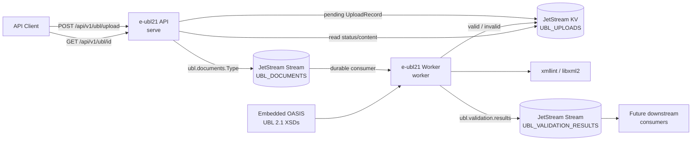
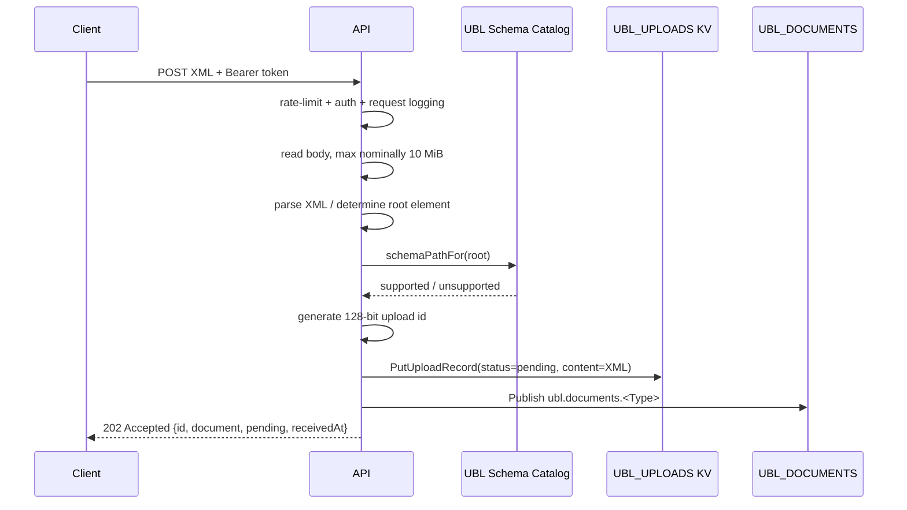
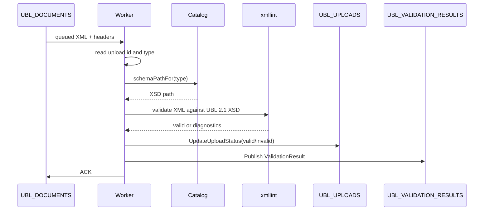
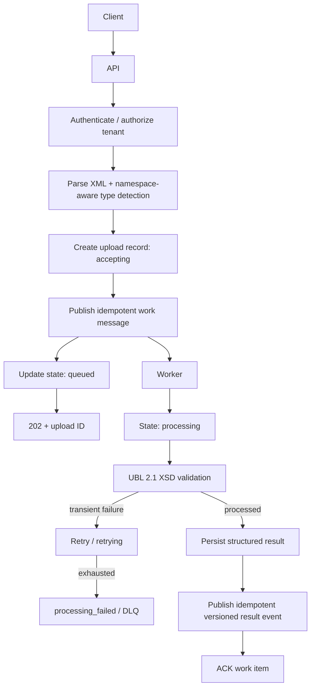

# e-ubl21 Server Dataflow and Architecture

**Project:** e-ubl21 / UBL-21 e-invoice validation  
**Document:** `SERVER-DATAFLOW-2026-08-24.md`  
**Status:** Current-state architecture and gap analysis  
**Date:** 24 August 2026

## 1. Purpose and scope

This document describes the current runtime architecture and dataflow of the **e-ubl21 server**, with particular emphasis on the asynchronous validation pipeline built around **NATS JetStream**.

The project currently has two major functional areas:

1. **OpenAPI/HTTP validation service** — accepts UBL 2.1 XML documents, performs lightweight synchronous checks, queues validation work, exposes validation status, and documents the HTTP contract through OpenAPI/Swagger.
2. **Sample generator** — generates structurally valid UBL 2.1 samples and is being extended with a semantic **EN 16931** generator.

### Current milestone boundary

The server currently validates **UBL 2.1 XSD structure only**. EN 16931 business-rule validation is **intentionally not part of the server at this stage**.

EN 16931 support belongs to the **sample-generator workstream for the current milestone**. The semantic generator should become a reliable producer of positive and negative EN 16931 fixtures before equivalent EN 16931 validation is introduced into the server.

This boundary is important:

```text
SERVER NOW                         SAMPLE GENERATOR NOW
----------                         --------------------
XML well-formedness                UBL structural samples
UBL document recognition           UBL XSD validation of samples
UBL 2.1 XSD validation             EN 16931 semantic model
Asynchronous queue processing      EN 16931 invoice variants
                                  EN 16931 fixture generation work

NO server-side EN 16931 yet        YES generator-side EN 16931
```

---

## 2. Repository architecture overview

The active project tree is organized around the following areas. The large XSD and generated-sample subtrees are summarized rather than expanded file-by-file.

```text
e-ubl21/
├── main.go
├── go.mod / go.sum
├── README.md
├── Dockerfile
├── docker-compose.yml
├── dev-config.sh
│
├── cmd/
│   ├── root.go
│   ├── serve.go
│   ├── worker.go
│   └── *_test.go
│
├── server/
│   ├── server.go
│   ├── upload.go
│   ├── worker.go
│   ├── worker_http.go
│   ├── schema_catalog.go
│   ├── auth.go
│   ├── ratelimit.go
│   ├── logging.go
│   ├── metrics.go
│   ├── openapi.go
│   ├── openapi.yaml
│   ├── lint-openapi.sh
│   ├── FUNCTIONALITY.md
│   └── *_test.go
│
├── queue/
│   ├── client.go
│   ├── infra.go
│   ├── subjects.go
│   ├── documents.go
│   ├── records.go
│   ├── results.go
│   ├── queue_test.go
│   └── queuetest/
│
├── XSD/
│   ├── embed.go
│   ├── common/       # OASIS UBL 2.1 shared schemas
│   └── maindoc/      # UBL 2.1 main-document schemas
│
├── createsamples/
│   ├── main.go
│   ├── commands.go
│   ├── inventory.go
│   ├── schemaindex.go
│   ├── xsdmodel.go
│   ├── generate.go
│   ├── values.go
│   ├── qname.go
│   ├── xmlnode/
│   ├── samples/      # generated UBL samples by document type
│   └── en16931/
│       ├── model.go
│       ├── calculate.go
│       ├── codelists.go
│       ├── variants.go
│       ├── build.go
│       ├── manifest.go
│       ├── *_test.go
│       └── testdata/official/
│
├── devsetup/
│   ├── download_ubl_2_1_all_xsds.sh
│   ├── download_en16931_validation_assets.sh
│   ├── download_saxon_he.sh
│   ├── minikube-abnd-docker-install.sh
│   └── utils/run-nats-standalone.sh
│
├── e-invoice/
│   └── E-INVOICE.md
│
├── ideas/
│   ├── MAIN-EN16931-UBL-validation.md
│   ├── EN16931-samples-generator-plan.md
│   ├── UBL21-Peppol.md
│   ├── peppol-spec.md
│   ├── AWS-KUBERNETES-SCALIBILITY.md
│   └── deployment-on-aws.md
│
└── .github/
    ├── roadmap-0.md
    ├── roadmap-1.md
    ├── devplan.md
    └── create-samples.md
```

### Architectural reading of the tree

The repository already has a good separation of responsibilities:

- `cmd/` is process/CLI orchestration.
- `server/` owns HTTP behavior, validation execution, security, OpenAPI, and observability.
- `queue/` encapsulates NATS/JetStream and acts as the boundary between API and worker.
- `XSD/` is the authoritative structural-validation asset bundle embedded into the binary.
- `createsamples/` is deliberately separate from server runtime behavior.
- `createsamples/en16931/` introduces a semantic-model-driven generator without contaminating the generic XSD-driven generator.
- `devsetup/` owns reproducible acquisition of standards/tooling assets.
- `ideas/` and `.github/` contain architecture and roadmap material.

---

## 3. Current runtime architecture

The executable is one Go binary with two runtime modes:

```text
e-ubl21 serve     -> HTTP/OpenAPI API process
e-ubl21 worker    -> asynchronous XSD-validation worker process
```

Both processes use the shared `queue` package and connect to NATS JetStream.



### Deployed locally with Docker Compose

`docker-compose.yml` currently defines:

- `nats` — NATS with JetStream enabled and file-backed persistence.
- `api` — same `e-ubl21` image, command `serve`.
- `worker` — same image, command `worker`.

This is a sound service split because API instances and validation workers can be scaled independently.

---

## 4. Queue topology

The queue layer is not merely planned; it is already implemented.

| Resource | Current name / subject | Purpose | Retention |
|---|---|---|---|
| Work stream | `UBL_DOCUMENTS` | Incoming UBL documents awaiting XSD validation | JetStream `WorkQueuePolicy`, file storage, 7-day `MaxAge` |
| Per-type work subject | `ubl.documents.<Type>` | Routes work by UBL root document type, e.g. `ubl.documents.Invoice` | Belongs to `UBL_DOCUMENTS` |
| Upload-state KV | `UBL_UPLOADS` | Canonical current upload record keyed by upload ID | JetStream KV, file storage; no explicit record TTL currently configured |
| Result stream | `UBL_VALIDATION_RESULTS` | Validation outcome events for downstream systems | `LimitsPolicy`, file storage, 7-day `MaxAge` |
| Result subject | `ubl.validation.results` | Single result-event subject for all document types | Belongs to result stream |

Both API and worker invoke `EnsureInfra()` at startup, so either service may start first.

### Work-message metadata

Every queued document carries:

- raw XML in the message body;
- `Ubl-Upload-Id` header;
- `Ubl-Document-Type` header;
- `Ubl-Received-At` header;
- `Nats-Msg-Id = upload ID` for JetStream input-message de-duplication.

This is a useful design choice: workers can route and correlate a document without parsing the XML payload merely to discover its identity.

---

## 5. Detailed current server dataflow

## 5.1 Startup: API process

`e-ubl21 serve` performs the following high-level initialization:

1. Cobra/Viper resolve configuration.
2. `server.NewHandler()` loads the UBL schema catalog.
3. Embedded `XSD/` assets are extracted to a temporary filesystem tree because `xmllint` requires real filesystem paths.
4. The catalog maps every UBL main-document root element to its corresponding XSD.
5. The API connects to NATS.
6. `queue.EnsureInfra()` creates/updates the streams and KV bucket.
7. OAuth validation, rate limiting, logging and Prometheus middleware are wired.
8. HTTP routes and Swagger/OpenAPI routes are registered.
9. The server starts HTTP or TLS depending on configuration.

Important current behavior: NATS is a **startup dependency** of the API. If the connection or JetStream infrastructure initialization fails, the HTTP handler is not created successfully.

---

## 5.2 Upload path: `POST /api/v1/ubl/upload`

The current upload path is intentionally asynchronous.



### Synchronous checks

The API currently performs only inexpensive checks before accepting work:

1. request body exists;
2. content type contains `xml` or `octet-stream`;
3. payload is well-formed XML;
4. a root element exists;
5. the root element local name is present in the UBL schema catalog.

The API **does not invoke `xmllint` synchronously**.

That means:

```text
well-formed XML + recognized UBL document root
                        │
                        ▼
                  202 Accepted
                        │
                        ▼
                    pending
```

A structurally invalid UBL document can therefore still receive `202`; its XSD failure appears asynchronously after the worker processes it.

### Persist-before-publish ordering

The API performs:

```text
1. Put pending UploadRecord in KV
2. Publish document to JetStream
3. Return 202
```

The intention is good: once the client receives `202`, an immediate `GET` should find at least the pending record.

However, this ordering introduces an important consistency gap discussed later: if step 1 succeeds and step 2 fails, a durable `pending` record remains with no queued work item.

---

## 5.3 Work routing by document type

There is **one physical work stream**, not one JetStream stream per UBL document type.

Logical separation is provided by subjects:

```text
UBL_DOCUMENTS
│
├── ubl.documents.Invoice
├── ubl.documents.CreditNote
├── ubl.documents.Order
├── ubl.documents.DespatchAdvice
├── ubl.documents.FreightInvoice
└── ubl.documents.<AnyOtherUBLMainDocument>
```

This is preferable to creating dozens of physical streams because it gives routing flexibility without multiplying broker infrastructure.

A worker can consume:

```text
ubl.documents.>
```

for all document types, or a narrower subject such as:

```text
ubl.documents.Invoice
```

for a dedicated Invoice worker pool.

### Current configurability

The NATS URL and worker subject filter are configurable. The physical stream/subject topology itself is currently hard-coded in `queue/subjects.go`.

Current fixed names include:

```text
UBL_DOCUMENTS
UBL_VALIDATION_RESULTS
UBL_UPLOADS
ubl.documents.
ubl.validation.results
```

This should become configurable through a single queue namespace/prefix. See `TODO.md`.

---

## 5.4 Worker startup

`e-ubl21 worker` performs:

1. signal-aware context setup for SIGINT/SIGTERM;
2. connect to NATS;
3. `EnsureInfra()`;
4. load/extract the UBL XSD schema catalog;
5. create or reuse a durable JetStream consumer;
6. optionally start internal `/metrics` and `/healthz` HTTP service;
7. begin consuming messages.

The default consumer name is:

```text
ubl-validator
```

The default filter means all UBL document subjects.

Multiple replicas using the same durable consumer provide competing-consumer/load-balancing behavior.

---

## 5.5 Worker processing path



### Validation engine

The worker executes:

```text
xmllint --noout --schema <main-document-xsd> <temporary-upload.xml>
```

The OASIS schema assets are embedded in the Go binary and extracted once to a process-local temporary tree.

### Outcome handling

A normal document ends in:

```text
pending -> valid
```

or:

```text
pending -> invalid
```

The worker considers both `valid` and `invalid` successful processing outcomes. An XSD-invalid document is not a worker failure; it is a successfully determined validation result.

### Retry behavior

Transient processing failures are retried:

- `xmllint` unavailable;
- upload-record update failure;
- result publication failure.

The worker issues a delayed NAK of approximately 10 seconds. The consumer configuration allows up to five deliveries and uses explicit acknowledgement.

An impossible unsupported document type is terminated instead of retried.

---

## 5.6 Result publication

After validation, the worker publishes JSON roughly equivalent to:

```json
{
  "id": "...",
  "documentType": "Invoice",
  "status": "valid",
  "validatedAt": "..."
}
```

or includes `error` for invalid documents.

All results share:

```text
ubl.validation.results
```

There is currently **no result consumer in this repository**. The stream is an integration seam for future systems such as:

- notifications;
- persistence/indexing;
- audit/event processing;
- billing/accounting of validations;
- webhooks;
- subsequent semantic validators.

For the current application, the client-visible result path is instead the KV-backed status endpoint.

---

## 5.7 Status retrieval: `GET /api/v1/ubl/{id}`

The API reads the record directly from `UBL_UPLOADS`.

The returned record currently contains:

```text
id
document type
status
received timestamp
original XML content
validated timestamp (once processed)
validation error (if invalid)
```

Thus NATS JetStream is currently doing three jobs:

```text
JetStream
├── work queue
├── event/result stream
└── operational document/status datastore (KV)
```

That is acceptable for the present phase but should be reconsidered when the Phase 3 multi-tenant persistence layer arrives.

---

## 6. Current API surface

The API currently exposes:

| Method | Endpoint | Purpose |
|---|---|---|
| `POST` | `/api/v1/ubl/upload` | Accept/queue UBL XML |
| `GET` | `/api/v1/ubl/{id}` | Retrieve content/current validation result |
| `GET` | `/` | Service metadata |
| `GET` | `/healthz` | API process liveness |
| `GET` | `/metrics` | Prometheus metrics |
| `GET` | `/openapi.json` | OpenAPI contract |
| `GET` | `/swagger/` | Swagger UI |

Swagger and the OpenAPI document are public; the remaining API routes are OAuth-protected.

---

## 7. Authentication and request protection

Current security includes:

- bearer token requirement;
- JWT HS256 signature validation;
- expiration enforcement;
- optional exact issuer match;
- optional audience validation;
- fail-closed behavior when the signing secret is absent;
- per-client-IP token-bucket rate limiting;
- optional TLS directly in the Go server.

Current auth is adequate for development/MVP but not yet the production OAuth/OIDC model defined by the wider project roadmap.

---

## 8. Observability

Prometheus instrumentation currently covers:

- HTTP request count;
- HTTP request duration;
- upload outcomes;
- validation outcomes;
- XSD-validation duration by document type;
- Go/runtime process metrics.

Structured logging uses `log/slog`.

The worker has a separate operational HTTP interface:

```text
/metrics
/healthz
```

Its health endpoint checks the actual NATS connection state, which is more meaningful than the API health endpoint's current process-only answer.

---

# 9. Sample generator architecture

The sample generator is a distinct executable/workstream and should stay conceptually separate from the online validation service.

Two generation strategies now exist.

## 9.1 Generic UBL structural generator

The existing `createsamples` implementation is **XSD-driven**.

It:

1. inventories UBL main schemas;
2. indexes schema/type relationships;
3. walks XSD structure;
4. constructs a minimal legal XML tree;
5. writes generated samples per document type;
6. validates them independently with `xmllint`.

It covers the full UBL main-document family.

Its responsibility is structural correctness, not invoice semantics.

---

## 9.2 EN 16931 semantic sample generator

`createsamples/en16931` deliberately uses a different model.

Rather than traversing the XSD graph, it represents EN 16931 business concepts and arithmetic explicitly.

Current pieces include:

### `model.go`

Defines semantic objects for:

- Invoice;
- CreditNote;
- supplier/buyer parties;
- payment means;
- invoice lines;
- VAT breakdown;
- monetary totals.

Money is represented as integer minor units rather than raw floating point.

### `calculate.go`

Provides derived financial calculations so related EN 16931 values are calculated rather than independently invented.

This is essential because an XSD can prove structure but cannot prove relationships such as:

```text
TaxInclusiveAmount = TaxExclusiveAmount + TaxAmount
```

### `codelists.go`

Contains curated valid codes for the semantic fixtures.

### `variants.go`

Implements the seven principal VAT-category Invoice families:

```text
S   standard rated
Z   zero rated
E   exempt
AE  reverse charge
G   export outside EU
K   intra-community supply
O   not subject to VAT
```

The repository history states that these seven variants were run through the official EN 16931 validation pipeline and adjusted according to real rule failures.

### `build.go`

Renders the semantic Invoice model into UBL XML using the shared `xmlnode` representation.

### EN 16931 tooling assets

Development scripts exist for pinned acquisition of:

- EN 16931 UBL validation XSLT release 1.3.16;
- Saxon-HE 12.7;
- xmlresolver 6.0.17.

This is the correct approach: standards artifacts are explicitly versioned and acquired reproducibly rather than downloaded dynamically during a request.

---

# 10. EN 16931 generator status and gaps

The EN 16931 generator has moved beyond design-only status, but it is not yet a finished test-corpus product.

## Implemented

- dedicated semantic package;
- business-term data model;
- exact monetary representation;
- arithmetic engine;
- curated code lists;
- seven Invoice VAT-category variants;
- UBL Invoice renderer;
- official positive reference fixtures;
- reproducible Saxon/EN16931 asset acquisition;
- tests for arithmetic/code-list pieces;
- manual/end-to-end validation evidence recorded in commit history/planning docs.

## Not yet complete

### CLI integration

The top-level `createsamples` CLI still exposes only:

```text
inventory
generate
validate
```

There is no user-facing EN 16931 generation command yet.

A later command should make the semantic path explicit, for example conceptually:

```text
createsamples generate-en16931 ...
```

The exact command name is a design choice.

### CreditNote rendering/corpus

The semantic model declares `CreditNoteDocument`, but the inspected renderer currently exposes `BuildInvoiceXML`; equivalent complete CreditNote generation is not yet evident in the current code.

### Manifest

`createsamples/en16931/manifest.go` is currently a placeholder comment.

The planned machine-readable manifest should record at least:

```text
fixture path
document type
variant / mutation id
expected XSD status
expected EN16931 status
expected rule id for targeted negative cases
validation asset version
```

### Targeted negative corpus

The seven positive VAT variants are present, but mutation-driven negative fixtures intentionally breaking named EN16931 rules still need to become first-class generated artifacts.

### Automated semantic validation command

The project has the tooling/scripts and manual validation path, but the semantic generator still needs a cohesive command that:

```text
generate fixture
      │
      ├── validate UBL XSD
      │
      └── run Saxon + EN16931 XSLT
              │
              ▼
          parse SVRL
              │
              ▼
      compare with manifest expectation
```

This should be CI-friendly and deterministic.

---

# 11. Server gaps

The current server is a good asynchronous UBL XSD-validation MVP. The following gaps matter before calling it production-grade.

## 11.1 Queue topology is not configurable

### Current state

Stream names, subject prefixes and KV bucket names are hard-coded.

### Risk

Multiple environments sharing one NATS cluster cannot be safely isolated by configuration alone.

### Recommendation

Introduce a configurable queue namespace/prefix and derive all physical names from it. Track this in `TODO.md`.

---

## 11.2 Pending-record / queue-publish consistency gap

### Current sequence

```text
KV Put(pending)        succeeds
JetStream Publish      fails
HTTP response           500
```

A durable pending record now exists but no worker will ever receive the document.

### Consequence

The system can create orphaned records permanently stuck at `pending`.

### Recommendation

Make acceptance state explicit. Options include:

1. publish first, then create status record with recovery logic;
2. introduce an `accepted`/`enqueue_failed` lifecycle and reconciliation worker;
3. use a transactional outbox pattern when a durable database arrives;
4. provide a compensating KV delete/update if publish fails.

For the current JetStream-only architecture, the simplest improvement is likely:

```text
create record with state = accepting
publish work
if success -> state = pending
if failure -> state = enqueue_failed
```

plus a reconciliation path.

---

## 11.3 Worker KV-update / result-publish consistency gap

Current processing order is:

```text
validate
   │
update KV
   │
publish result
   │
ACK input
```

If the KV update succeeds but result publication fails, the message is redelivered.

On the retry:

- validation runs again;
- KV is updated again;
- result publication is attempted again.

This is safe enough for the current KV state but introduces **at-least-once result publication semantics**.

### Recommendation

Treat result events as explicitly idempotent:

- set `Nats-Msg-Id` on validation-result events too, preferably derived from upload ID + validation-stage/version;
- document downstream consumers as idempotent;
- later consider an event/outbox model.

---

## 11.4 No explicit dead-letter flow

The consumer has `MaxDeliver: 5`, but the application does not expose a deliberate terminal processing-failure workflow.

### Missing concepts

```text
processing_failed
dead_lettered
last_error
attempt_count
```

### Risk

After repeated infrastructure failures a document may stop being delivered while its KV record remains `pending`.

### Recommendation

Introduce an explicit DLQ/advisory handler or retry-exhaustion reconciliation process and a terminal failure state visible through the API.

---

## 11.5 Upload lifecycle is too coarse

Current statuses:

```text
pending
valid
invalid
```

For asynchronous operations, a stronger lifecycle is:

```text
accepting
queued
processing
valid
invalid
processing_failed
```

Optionally:

```text
retrying
dead_lettered
expired
```

This makes production diagnosis considerably easier.

---

## 11.6 `xmllint` execution is not bounded by a validation timeout

`validateAgainstSchema()` uses `exec.Command`, not a context-bound `exec.CommandContext` with a specific validation deadline.

### Risk

A hung/hostile/problematic external validator process could occupy a worker indefinitely.

### Recommendation

Use a configurable validation timeout:

```text
EUBL21_XSD_VALIDATION_TIMEOUT
```

and execute the validator with context cancellation.

Also bound:

- output capture size;
- temporary-file usage;
- concurrent validator subprocess count.

---

## 11.7 Validation diagnostics are unstructured

Current XSD errors are essentially a trimmed `xmllint` stdout/stderr message stored as one string.

The broader roadmap requires useful diagnostics such as:

```text
line
column
message
schema/component context
```

### Recommendation

Define a structured validation error model and parse libxml2 diagnostics into it.

---

## 11.8 API health check is not dependency-aware

The worker `/healthz` tests NATS connection state.

The API `/healthz` currently just returns:

```json
{"status":"ok"}
```

even though upload/status operation depends on JetStream.

### Recommendation

Separate Kubernetes-style endpoints:

```text
/livez     process is alive
/readyz    NATS + JetStream + required validation/catalog dependencies ready
```

Keep `/healthz` only if compatibility requires it.

---

## 11.9 API server lacks graceful shutdown

The worker handles termination signals explicitly; the API currently does not perform equivalent graceful HTTP shutdown.

### Recommendation

Handle SIGINT/SIGTERM in the server command and invoke `http.Server.Shutdown()` with a bounded grace period.

---

## 11.10 NATS connection lifecycle in API

The API creates a queue client when building the handler, but the handler abstraction does not visibly expose a close/shutdown hook for the NATS connection.

This matters once graceful shutdown is implemented.

### Recommendation

Represent the server as a lifecycle-owning application object rather than returning only an `http.Handler`, or return a cleanup function alongside the handler.

---

## 11.11 Root-element recognition should include namespace

The upload detector currently obtains the XML root's local name and compares that local name to the main-document catalog.

UBL identity is more safely represented as:

```text
{namespace URI} + local name
```

rather than local name alone.

### Example risk

An arbitrary XML document whose root happens to be named `Invoice` could pass the cheap recognition stage and be queued, only to fail later under XSD.

### Recommendation

Validate both:

```text
Local = Invoice
Namespace = urn:oasis:names:specification:ubl:schema:xsd:Invoice-2
```

before acceptance.

---

## 11.12 Request-size enforcement has an edge case

`io.LimitReader(r.Body, 10<<20)` limits bytes read, but without reading one extra byte or explicitly checking body length it can silently truncate a payload larger than the limit rather than distinctly report `413 Payload Too Large`.

### Recommendation

Use `http.MaxBytesReader` or read up to `limit + 1` and reject oversized requests explicitly.

---

## 11.13 Queue/KV storage growth policy

`UBL_DOCUMENTS` and result messages have `MaxAge` limits.

`UBL_UPLOADS` does not currently define an explicit record TTL.

Because each record includes the complete original XML payload, storage can grow indefinitely.

### Recommendation

Define retention as a product-level policy:

```text
validation-status retention
raw XML retention
result-event retention
audit retention
```

Eventually Phase 3 persistence should become the durable business store, while JetStream KV should probably remain an operational/state store rather than permanent document storage.

---

## 11.14 Results stream has no in-repo consumer

This is currently intentional, not necessarily a bug.

However its contract should be made explicit before external consumers depend on it:

- schema/version field;
- event ID;
- correlation ID;
- validation-engine version;
- UBL schema version;
- timestamp semantics;
- idempotency semantics;
- future compatibility policy.

---

## 11.15 Queue observability is incomplete

Application metrics cover validations but not broker state.

Production operation needs visibility into:

```text
consumer lag
pending messages
redelivery count
retry count
age of oldest queued message
DLQ count
NATS reconnects
publish latency/errors
KV write latency/errors
```

These are especially important for autoscaling workers.

---

## 11.16 Rate limiting is local to each API replica

The current in-memory per-IP limiter is appropriate for a single instance but multiplying API replicas multiplies the effective rate limit.

### Recommendation

For a Kubernetes/public deployment, enforce coarse rate limiting at ingress/API gateway level and retain local limiting as a second defensive layer if desired.

---

## 11.17 OAuth/OIDC production gaps

Current auth supports HS256 only.

Missing production capabilities include:

- JWKS discovery;
- asymmetric signing (`RS256`, `ES256`, etc.);
- key rotation;
- scopes/permissions;
- tenant/customer identity binding;
- possibly OIDC discovery metadata.

The roadmap already anticipates an external standards-compliant authorization provider.

---

## 11.18 No tenant ownership in current upload records

`UploadRecord` currently has no customer/tenant identifier.

This is acceptable for the present validation MVP but incompatible with the long-term multi-tenant architecture.

### Recommendation

Introduce tenant identity before exposing durable cross-user document retrieval in production. It should be derived/authorized from authenticated claims rather than trusted from arbitrary request data.

---

## 11.19 OpenAPI has two representations that can drift

The server constructs an OpenAPI document in Go (`openapi.go`) while a static `openapi.yaml` is also maintained for external tooling.

Two independently maintained sources are a drift risk.

### Recommendation

Choose one authoritative representation.

Given the existing project decision for specification-first OpenAPI, the preferred direction is:

```text
server/openapi.yaml = source of truth
               │
               ├── lint/validate in CI
               └── served by API / used to generate bindings or checks
```

rather than maintaining a second handwritten Go representation of the same contract.

---

## 11.20 NATS production security/HA not implemented

Local Docker Compose currently runs one NATS server with JetStream persistence but no application-defined broker authentication/TLS topology.

Production needs decisions around:

- TLS;
- credentials/NKeys/accounts;
- JetStream replication;
- multi-node cluster;
- resource quotas;
- backup/restore;
- monitoring;
- failure-domain placement.

---

# 12. Server EN 16931 status

The absence of EN 16931 validation in the server is **not considered a current implementation defect** under the present milestone definition.

Current server pipeline:

```text
XML
 │
 ▼
well-formedness
 │
 ▼
UBL type recognition
 │
 ▼
queue
 │
 ▼
UBL 2.1 XSD validation
 │
 ▼
result
```

Future pipeline may become:

```text
XML
 │
 ▼
well-formedness
 │
 ▼
UBL recognition
 │
 ▼
queue
 │
 ▼
UBL 2.1 XSD
 │
 ├─ fail -> result
 │
 ▼ pass
EN 16931
 │
 ├─ fail -> result
 │
 ▼ pass
optional Peppol / country rules
 │
 ▼
final validation result
```

That later validation-stage composition should probably remain worker-based rather than moving expensive semantic processing back into the synchronous API request.

---

# 13. Recommended near-term architecture

Before adding EN 16931 to the server, harden the existing asynchronous UBL validation path.

Recommended progression:

```text
1. Queue namespace configurability
2. Namespace-aware UBL document recognition
3. Explicit asynchronous lifecycle states
4. Reliable enqueue failure/reconciliation behavior
5. Validator execution timeout/resource bounds
6. Structured XSD diagnostics
7. Dead-letter / retry exhaustion handling
8. Result-event idempotency/versioning
9. Dependency-aware readiness
10. Graceful API shutdown
11. Queue/consumer observability
12. Production OAuth/OIDC + tenant identity
13. Production NATS security/HA
14. Automated EN 16931 generator corpus
15. Only then introduce EN 16931 server validation
```

This order keeps the architecture from becoming a tower of validation stages sitting on top of an unreliable work lifecycle.

---

# 14. Recommended target queued dataflow

A hardened next version could use this lifecycle:



EN 16931 is deliberately omitted from that immediate target diagram because the current milestone keeps it in the generator workstream.

---

# 15. Overall assessment

The project has advanced significantly beyond its initial command-line scaffold.

The **server** already has a coherent asynchronous architecture:

```text
HTTP ingestion
+ OAuth/rate limiting
+ UBL type recognition
+ NATS JetStream work queue
+ horizontally scalable workers
+ real xmllint/XSD validation
+ durable status records
+ result events
+ OpenAPI/Swagger
+ Prometheus/logging
+ Docker deployment
```

The decision to move validation into a queue/worker pipeline was a strong one. It separates latency-sensitive API admission from expensive XML standards work and creates a natural place to add later validation stages without tying up HTTP requests.

The largest remaining server work is therefore less about adding another feature and more about **hardening the asynchronous contract**: atomicity/reconciliation, lifecycle states, retries/DLQ, idempotency, timeouts, namespace correctness, dependency readiness, tenancy, and production broker/security configuration.

The **sample-generator** side has also split along the correct architectural seam:

```text
Generic UBL generator       EN 16931 generator
---------------------       ------------------
XSD-driven                  semantic-model-driven
all UBL doc types           Invoice/CreditNote focus
structural validity         business-rule validity
placeholder-safe values     reconciled money + legal codes
```

EN 16931 work should continue there until generation, manifest production, positive/negative corpus creation and automated Saxon/SVRL verification are cohesive. Once that corpus is reliable, it becomes the ideal foundation for introducing EN 16931 into the queued server validation pipeline.
