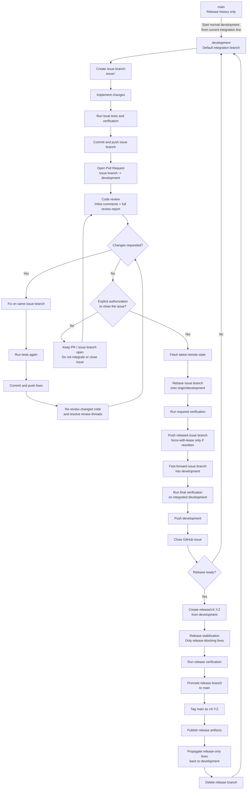

# Development Workflow

This document summarizes the repository development, review, integration, and release workflow.

## Workflow diagram



## Branch flow

```text
issue/<number>-<description>
        |
        |  commit -> push -> PR -> review -> fix -> re-review
        v
   development
        |
        |  release candidate
        v
 release/vX.Y.Z
        |
        |  promote after release verification
        v
      main
        |
        v
     tag vX.Y.Z
```

## Core rules

1. Normal development starts from the synchronized local `development` branch.
2. Every GitHub issue is implemented on its own `issue/<number>-<description>` branch.
3. Changes are committed and pushed to the issue branch, then reviewed through a Pull Request targeting `development`.
4. Review is iterative: fix comments on the same issue branch, push again, and re-review until the PR is clean.
5. Reviewing, fixing, committing, pushing, or opening a PR does **not** authorize integration or issue closure.
6. Only explicit authorization to close a specific issue starts the rebase-first, fast-forward-only integration workflow.
7. Issue branches are rebased onto current `origin/development`; `development` is never merged into an issue branch.
8. Issue branches are integrated into `development` with fast-forward only.
9. `main` is reserved for release history. Day-to-day work never integrates directly into `main`.
10. Release branches are temporary `release/vX.Y.Z` branches created from `development` and deleted after release completion.
11. Any fixes made only on a release branch must be propagated back into `development`.

## Typical issue workflow

```text
git fetch origin --prune
git switch development
git pull --ff-only origin development
git switch -c issue/<number>-<description>

# implement + test

git add ...
git commit -m "..."
git push -u origin issue/<number>-<description>

# open PR: issue branch -> development
# review -> fix -> commit -> push -> re-review

# only after explicit authorization to close the issue:
git fetch origin --prune
git switch issue/<number>-<description>
git rebase origin/development
# run verification
git push --force-with-lease origin issue/<number>-<description>  # only if rebase rewrote published commits

git switch development
git pull --ff-only origin development
git merge --ff-only issue/<number>-<description>
# run final verification
git push origin development
```
