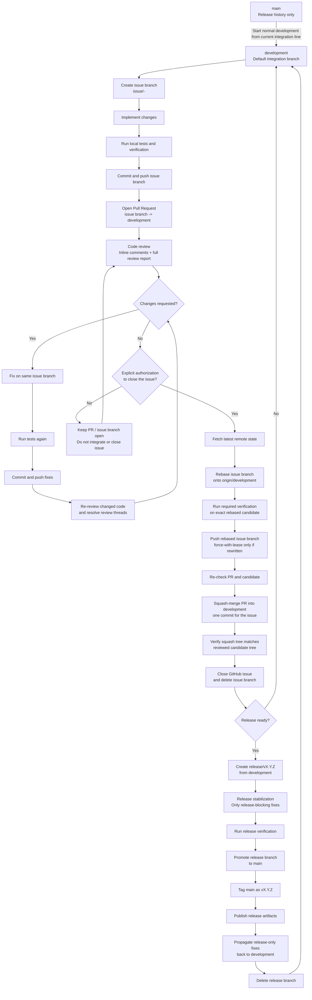

# Development Workflow

This document summarizes the repository development, review, integration, and release workflow.

## Workflow diagram



## Branch flow

```text
issue/<number>-<description>
        |
        |  commit -> push -> PR -> review -> fix -> re-review
        |  (any number of temporary issue-branch commits)
        v
   squash merge
        |
        |  exactly one development commit per issue
        v
   development
        |
        |  release candidate
        v
 release/vX.Y.Z
        |
        |  promote after release verification
        v
      main
        |
        v
     tag vX.Y.Z
```

## Core rules

1. Normal development starts from the synchronized local `development` branch.
2. Every GitHub issue is implemented on its own `issue/<number>-<description>` branch.
3. Changes are committed and pushed to the issue branch, then reviewed through a Pull Request targeting `development`.
4. Review is iterative: fix comments on the same issue branch, push again, and re-review until the PR is clean. The issue branch may contain as many implementation and review-fix commits as are useful.
5. Reviewing, fixing, committing, pushing, or opening a PR does **not** authorize integration or issue closure.
6. Only explicit authorization to close a specific issue starts the final rebase-and-squash integration workflow.
7. Before integration, the issue branch is rebased onto current `origin/development`; `development` is never merged into an issue branch.
8. The exact rebased candidate must pass the required verification before integration. If the rebase changes the candidate commit, applicable verification must be rerun.
9. Every issue is integrated into `development` with **squash merge only**. The resulting `development` history contains exactly one integration commit per completed issue, regardless of how many commits existed on the issue branch.
10. Merge commits and GitHub's rebase-merge method are not used for normal issue integration. The GitHub PR **Squash and merge** operation is the standard integration mechanism.
11. After the squash merge, verify that the squash commit's tree matches the reviewed/tested issue-branch candidate tree. A mismatch is an integration failure and must be investigated before the work is treated as complete.
12. The PR and its issue-branch commits remain the detailed review/audit trail; the squash commit is the canonical issue-level history on `development`.
13. Delete the completed issue branch only after the squash commit is confirmed on `development` and the tree-equivalence check succeeds.
14. `main` is reserved for release history. Day-to-day work never integrates directly into `main`.
15. Release branches are temporary `release/vX.Y.Z` branches created from `development` and deleted after release completion.
16. Any fixes made only on a release branch must be propagated back into `development`.

## Typical issue workflow

```text
git fetch origin --prune
git switch development
git pull --ff-only origin development
git switch -c issue/<number>-<description>

# implement + test

git add ...
git commit -m "..."
git push -u origin issue/<number>-<description>

# open PR: issue branch -> development
# review -> fix -> commit -> push -> re-review
# any number of issue-branch commits is acceptable

# only after explicit authorization to close the issue:
git fetch origin --prune
git switch issue/<number>-<description>
git rebase origin/development
# run all required verification against this exact rebased candidate
git push --force-with-lease origin issue/<number>-<description>  # only if rebase rewrote published commits

# re-check the PR and confirm the reviewed candidate is still clean
# then use GitHub PR: Squash and merge
# use an issue-oriented squash commit title/message, including the issue number

# verify the resulting development squash commit has the same tree as the
# reviewed/tested issue-branch candidate, then close the issue if not already
# closed by the PR and delete the issue branch.
```
