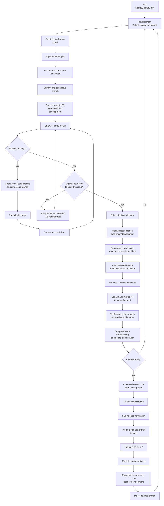

# Repository Workflow

This file is the **single authoritative source** for the e-ubl21 development, review, integration, issue-closure, regression-gating, and release workflow.

Other Markdown files may describe technical work, implementation order, migration plans, or issue history, but they must **not redefine repository workflow**. They should link to this file instead. If another document conflicts with this file on branch, review, integration, closure, regression-gating, or release procedure, **`workflow.md` governs**.

## Workflow diagram



## Branch model

The repository uses a GitFlow-lite model with three branch roles:

- `main` is release history only. Day-to-day development does not integrate directly into `main`. Every release commit on `main` must be tagged with its release version.
- `development` is the default integration branch for ongoing work. Normal issue branches start from `development` and integrate back into `development`.
- `release/vX.Y.Z` branches are temporary release-stabilization branches created from `development`. There is no permanent `release` branch.

Normal flow:

```text
issue/<number>-<description>
        |
        | implementation/review commits
        v
   squash merge
        |
        | exactly one canonical development commit per issue
        v
   development
        |
        v
 release/vX.Y.Z
        |
        v
      main
        |
        v
     tag vX.Y.Z
```

Release-only fixes made on `release/vX.Y.Z` must be propagated back into `development`.

## Required repository settings

Where the GitHub plan supports enforcement:

- set `development` as the default branch;
- protect `main` from direct day-to-day pushes, force pushes, and deletion;
- protect `development` from force pushes and deletion;
- keep issue-level history linear on `development` and `main` unless an explicit exception is authorized;
- enable **Squash and merge** for normal issue PR integration;
- do not use merge commits or GitHub rebase-merge for normal issue integration;
- when hosted regression execution is enabled, require the applicable correctness, Minikube, and standards-validation checks for protected integration paths;
- do not create a permanent `release` branch.

If server-side protection is unavailable, these rules remain project policy and must be enforced procedurally.

## Local development branch

Every working clone must maintain a local `development` branch tracking `origin/development`.

If it does not exist:

```bash
git fetch origin --prune
git switch -c development --track origin/development
```

If it already exists:

```bash
git switch development
git branch --set-upstream-to=origin/development development
git pull --ff-only origin development
```

Verify with:

```bash
git branch -vv
```

The `development` entry must show `[origin/development]`.

Do not start issue work from detached `origin/development`, `main`, or a release branch.

## Issue branch creation

Each GitHub issue is implemented on its own branch created from synchronized local `development`.

```bash
git fetch origin --prune
git switch development
git pull --ff-only origin development
git switch -c issue/<number>-<description>
```

Rules:

1. Keep the branch scoped to the active issue.
2. Implement and run focused tests on the issue branch.
3. Commit and push reviewable work to that branch.
4. Create or update a pull request targeting `development`.
5. The issue branch may contain as many implementation and review-fix commits as useful. They are retained as detailed audit history even though integration is squashed.
6. Do not merge `development` into an issue branch. Rebase onto `development` only when the workflow calls for it or when explicitly needed during development.

## Review roles

The review roles are deliberately separated:

- **ChatGPT is the designated code reviewer.** It reviews the complete PR diff against the issue acceptance criteria, repository contracts, architecture, regression behavior, tests, and prior unresolved findings.
- **Codex in VS Code is the implementation and fix agent.** It implements the issue, runs focused verification, commits and pushes work, and fixes findings supplied by ChatGPT.
- **Codex does not perform a second independent full review by default.** This avoids duplicate repository analysis and unnecessary coding-agent credit consumption.
- While fixing a finding, Codex may explain why a specific finding appears incorrect or surface a newly discovered problem. That does not authorize another broad review unless explicitly requested.

## Pull-request review cycle

The PR is the normal code-review surface. Creating, updating, or reviewing a PR is part of implementation, **not issue closure**.

The required loop is:

1. Codex or the user implements the issue and runs appropriate focused tests.
2. Commit and push the issue branch.
3. Create or update the PR targeting `development`.
4. The user asks ChatGPT to review the PR.
5. ChatGPT reviews the complete current PR and produces findings.
6. The user gives the findings to Codex.
7. Codex fixes the listed findings, adds or updates tests where required, runs affected verification, commits, and pushes.
8. ChatGPT re-reviews the updated PR.
9. Repeat until there are no unresolved blocking findings.

During this loop:

- do not ask Codex for a redundant full review of the same PR state unless explicitly wanted;
- do not rebase merely because a review iteration completed;
- do not squash-merge or otherwise integrate the issue branch;
- do not close the PR as merged;
- do not close the GitHub issue;
- do not treat a clean review as authorization to integrate or close the issue.

The PR, review comments, and issue-branch commits remain the detailed audit trail. Resolved review comments should not be deleted merely because they are resolved.

## Explicit authorization boundary

Neither ChatGPT nor Codex may close or integrate a GitHub issue unless the user explicitly instructs it to **close that specific issue**.

Requests to implement, test, commit, push, create a PR, review a PR, update documentation, add comments, or address findings are not closure authorization.

Until explicit closure authorization is given:

- keep the issue branch and PR open;
- do not begin the final integration rebase;
- do not squash-merge the PR;
- do not update `development` with the issue changes through another integration route;
- do not change the GitHub issue state to closed.

If closure intent is ambiguous, ask rather than infer it.

## Final rebase-and-squash integration

Once the user explicitly instructs that a specific issue be closed:

1. Fetch the latest remote state and ensure the working tree is clean.
2. Switch to the issue branch.
3. Rebase the issue branch onto current `origin/development`:

   ```bash
   git fetch origin --prune
   git switch issue/<number>-<description>
   git rebase origin/development
   ```

4. Resolve conflicts on the issue branch. If a conflict requires a substantive architectural choice, stop and obtain guidance rather than guessing.
5. Run the tests and verification required by the issue/repository against the **exact rebased candidate**.
6. If published commits were rewritten, push with:

   ```bash
   git push --force-with-lease origin issue/<number>-<description>
   ```

   Otherwise use a normal push as appropriate.
7. Re-check the PR after the rebase for conflict-resolution regressions or new blocking findings.
8. Confirm `development` has not advanced since the rebase. If it has, rebase again, repeat required verification, push, and re-check.
9. Integrate with GitHub **Squash and merge**. The squash commit title/message should identify the issue clearly.
10. Verify immediately that the resulting squash commit is on `development` and that its tree matches the reviewed/tested issue-branch candidate tree.
11. If the trees differ, treat integration as failed and investigate before completing closure.
12. Complete PR/issue bookkeeping and close the GitHub issue if it was not automatically closed.
13. Delete the issue branch only after the squash commit and tree equivalence have been confirmed.

The integration invariant is:

> **one GitHub issue -> one canonical squash commit on `development`**

Do not:

- merge `development` into an issue branch;
- integrate a normal issue branch directly into `main`;
- integrate a normal issue branch directly into `release/vX.Y.Z`;
- use a merge commit for normal issue integration;
- use GitHub rebase-merge for normal issue integration;
- close the issue before successful squash integration and tree-equivalence verification.

## Regression policy

### Temporary local-regression policy

GitHub-hosted execution of correctness and Minikube/Kubernetes regression gates is temporarily suspended.

Until that suspension is explicitly lifted, the authoritative repository regression gate is:

```bash
./run-regression-tests.sh
```

Rules during the suspension:

- run the local regression suite against the exact candidate being reviewed or integrated whenever regression verification applies;
- any failed suite or non-zero exit blocks integration, issue closure, and release promotion;
- retain generated regression reports/evidence long enough to review failures and identify the tested commit;
- rerun the applicable regression gate after a rebase or other substantive candidate-changing modification;
- run the local regression suite on the release-candidate state before release promotion;
- skipped, disabled, unavailable, or unexecuted hosted regression workflows are not themselves blocking while this temporary policy is active;
- the suspension changes only where regression verification runs. It does not weaken semantic, standards, correctness, equivalence, Minikube, or acceptance criteria.

### Focused tests versus full regression

During implementation, prefer focused unit/integration tests that cover the changed area. Do not repeatedly run the full repository regression suite after every small edit.

Run the full applicable regression gate when the candidate is genuinely ready for qualification, and rerun it when a subsequent substantive change or rebase invalidates that qualification evidence.

This keeps verification rigorous while avoiding unnecessary local and coding-agent resource consumption.

### CI branch policy

When hosted execution is active, PRs targeting and pushes to `development`, `release/vX.Y.Z`, or `main` should run the relevant correctness and compliance gates. `main` CI is a release-verification safety net, not the normal development integration path.

Cleanup of completed `issue/*` branches is based on successful squash integration and tree equivalence, not ancestry of the issue branch's individual commits.

## Release preparation

Create a release branch only when a concrete version is ready for stabilization.

1. Ensure `development` contains all work selected for the release and required verification passes.
2. Create `release/vX.Y.Z` from the current release candidate on `development`.
3. Freeze feature work on that branch. Only release-blocking fixes, versioning, packaging, documentation, and release-hardening changes belong there.
4. Validate the complete release candidate.
5. Promote the release branch to protected `main` through the approved release integration path.
6. Tag the resulting release commit on `main` as `vX.Y.Z`.
7. Push the tag and publish release artifacts.
8. Propagate any release-only fixes back into `development`.
9. Delete the release branch after release completion and after all release-only fixes are safely present in `development`.

`main` remains unchanged between releases except for approved release promotions.

## Typical issue workflow

```bash
# Start
git fetch origin --prune
git switch development
git pull --ff-only origin development
git switch -c issue/<number>-<description>

# Implement and run focused tests
git add ...
git commit -m "..."
git push -u origin issue/<number>-<description>

# Open/update PR -> development
# ChatGPT review -> Codex fixes -> focused tests -> push -> ChatGPT re-review
# Repeat until clean. Do not integrate yet.

# Only after explicit instruction to close this specific issue:
git fetch origin --prune
git switch issue/<number>-<description>
git rebase origin/development

# Run required qualification against the exact rebased candidate.
# If published commits were rewritten:
git push --force-with-lease origin issue/<number>-<description>

# Re-check PR/candidate.
# GitHub: Squash and merge into development.
# Verify squash tree == reviewed candidate tree.
# Then complete issue closure and delete the issue branch.
```
